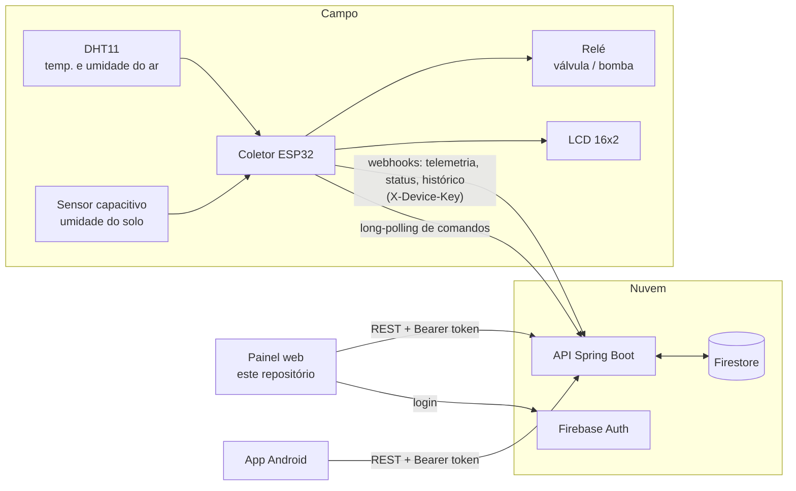

# SmartIrrigation — Front-end Web

Painel web em Angular do **SmartIrrigation**, um sistema de irrigação inteligente para agricultura sustentável. Pelo painel é possível acompanhar os sensores em tempo real, ligar e desligar a irrigação manualmente, deixar o sistema irrigar sozinho (modo automático), configurar a cultura plantada e os parâmetros agronômicos, e consultar o histórico em gráficos.

Este repositório é uma das três partes do sistema:

| Parte | Repositório | Tecnologia | Papel |
|---|---|---|---|
| **Coletor** | [`smart-irrigation-colector`](https://github.com/jorgearaujor/smart-irrigation-colector) | ESP32 (Arduino / FreeRTOS) | Lê os sensores no campo, calcula a necessidade de água e aciona a válvula/bomba |
| **API** | [`smart-irrigation-api`](https://github.com/jorgearaujor/smart-irrigation-api) | Java 17 + Spring Boot + Firebase | Centraliza os dados, guarda tudo no Firestore e repassa comandos ao coletor |
| **Front-end** (este) | [`smart-irrigation-front`](https://github.com/jorgearaujor/smart-irrigation-front) | Angular 21 + Tailwind | Painel para o usuário monitorar e controlar o sistema |

Há também um app mobile (Android/Kotlin) em [`SmartIrrigation`](https://github.com/jorgearaujor/SmartIrrigation).

---

## Sumário

- [Visão geral do sistema](#visão-geral-do-sistema)
- [O coletor (ESP32)](#o-coletor-esp32)
- [Front-end: stack](#front-end-stack)
- [Como rodar o front](#como-rodar-o-front)
- [Variáveis de ambiente](#variáveis-de-ambiente)
- [Telas e funcionalidades](#telas-e-funcionalidades)
- [Perfis de acesso](#perfis-de-acesso)
- [Endpoints da API consumidos](#endpoints-da-api-consumidos)
- [Arquitetura do código](#arquitetura-do-código)
- [Deploy](#deploy)
- [Licença](#licença)

---

## Visão geral do sistema



### Como os dados circulam

1. **Leitura no campo.** A cada 10 s o coletor lê temperatura, umidade do ar e umidade do solo e envia para a API (`POST /api/webhooks/telemetry`). A cada 20 s ele também envia o próprio status: modo, autorização, se está irrigando, latitude etc. (`POST /api/webhooks/status`).
2. **Armazenamento.** A API grava tudo no Firestore: o status atual em `devices/{id}`, as leituras em `devices/{id}/telemetry` e as irrigações em `devices/{id}/irrigationHistory`.
3. **Visualização.** O painel consulta a API em intervalos regulares (status a cada 5 s, telemetria a cada 10 s) e atualiza a tela sozinho.
4. **Comandos.** Quando o usuário faz uma ação no painel (por exemplo "irrigar 20 L"), a API **coloca um comando na fila**. O coletor não recebe chamadas de fora: ele fica perguntando à API por novos comandos (*long-polling* em `GET /api/devices/{id}/commands/poll`, com espera de até 30 s). Quando chega um comando, ele executa e devolve o status atualizado.
5. **Histórico.** Ao fim de cada irrigação, manual ou automática, o coletor envia um registro com duração, volume, umidade antes da rega e modo (`POST /api/webhooks/history`). Esse registro aparece na tela de Histórico.

---

## O coletor (ESP32)

O coletor é o firmware que roda no ESP32 instalado no campo. O código fica em [`smart-irrigation-colector`](https://github.com/jorgearaujor/smart-irrigation-colector), no arquivo único `irrigation_controller_esp32.ino`, que abre direto na Arduino IDE.

### Hardware

| Componente | Função | Pino (ESP32) |
|---|---|---|
| ESP32 Dev Module | Microcontrolador com Wi-Fi | — |
| DHT11 | Temperatura e umidade do ar | GPIO 27 |
| Sensor de umidade do solo (analógico) | Umidade do solo (%) | GPIO 34 (ADC, só entrada) |
| Módulo relé | Liga/desliga a válvula ou bomba | GPIO 26 |
| LCD 16x2 com módulo I2C (endereço `0x27`) | Mostra temperatura, umidade e modo no local | SDA/SCL padrão (GPIO 21/22) |

O relé começa **desligado** sempre que o ESP32 liga, por segurança.

### Bibliotecas (Arduino Library Manager)

- **DHT sensor library** (Adafruit) + **Adafruit Unified Sensor**
- **LiquidCrystal_I2C** (marcoschwartz)
- **ArduinoJson** (bblanchon, v7)

`WiFi`, `HTTPClient` e `esp_adc_cal` já vêm no pacote de placas do ESP32.

### Como gravar o firmware

1. Instale o suporte ao ESP32 na Arduino IDE e as bibliotecas acima.
2. No topo do `.ino`, preencha:
   - `WIFI_SSID` e `WIFI_PASSWORD`: a rede Wi-Fi do local;
   - `API_BASE_URL`: o endereço da API (sem `/api` no final);
   - `DEVICE_ID`: o identificador do dispositivo (o painel usa `esp32-01`);
   - `DEVICE_API_KEY`: precisa ser **igual** ao `DEVICE_API_KEY` do `.env` da API.
3. Selecione a placa **ESP32 Dev Module** e grave.
4. Abra o Monitor Serial (115200 baud) para acompanhar os logs.

> ⚠️ **Não versione a senha do Wi-Fi nem a `DEVICE_API_KEY` reais.** Deixe esses campos vazios no repositório e preencha só na sua cópia local antes de gravar.

### Calibração do sensor de solo

A umidade do solo é calculada a partir da tensão lida no ADC (média de 16 amostras):

```
umidade (%) = (SOIL_MAX_VOLTAGE − tensão) / (SOIL_MAX_VOLTAGE − SOIL_MIN_VOLTAGE) × 100
```

- `SOIL_MAX_VOLTAGE` é a tensão com o sensor **seco** (0 %). O padrão é 2,8 V.
- `SOIL_MIN_VOLTAGE` é a tensão com o sensor **na água** (100 %). O padrão é 1,2 V.

Esses valores variam de um sensor para outro. Depois de montar o hardware, meça os dois extremos pelo Monitor Serial e ajuste as constantes.

### O que acontece ao ligar

1. Conecta no Wi-Fi e sincroniza o relógio via NTP (fuso UTC−3).
2. Inicializa relé, sensores e LCD.
3. Busca na API a configuração salva (`GET /api/devices/{id}/config`): modo, autorização, latitude e parâmetros agronômicos. Se a API não responder, segue com os valores padrão do firmware.
4. Cria as tarefas paralelas (FreeRTOS):

| Tarefa | Frequência | O que faz |
|---|---|---|
| `sensorTask` | a cada 10 s | Lê os sensores, envia a telemetria, atualiza o LCD e, se for o caso, dispara a irrigação automática |
| `statusSyncTask` | a cada 20 s | Envia o status atual para a API |
| `commandPollTask` | contínuo | Fica no long-polling esperando comandos do painel |
| `irrigationTask` | sob demanda | Mantém o relé ligado pelo tempo calculado e depois envia o histórico |

O estado compartilhado entre as tarefas é protegido por *mutex*, e só uma irrigação roda por vez.

### Modo automático: como ele decide quanto irrigar

O modo automático só rega quando **as três condições** são verdadeiras: o modo está em `automatico`, a irrigação automática está **autorizada** no painel e a umidade do solo está **abaixo do limiar** configurado (padrão 50 %).

Quando isso acontece, o coletor calcula a quantidade de água:

1. **Evapotranspiração de referência (ETo)**, pela fórmula de **Hargreaves-Samani**. Ela usa as temperaturas mínima e máxima registradas, a latitude do local e o dia do ano:
   ```
   ETo = 0,0023 × Ra × √(Tmax − Tmin) × (Tmédia + 17,8)      [mm/dia]
   ```
   `Ra` é a radiação extraterrestre, calculada a partir da latitude e do dia do ano.
2. **Evapotranspiração da cultura:** `ETc = ETo × Kc`. O `Kc` depende da cultura e da fase de crescimento escolhidas no painel.
3. **Volume por planta:** `ETc × (espaçamento entre plantas × espaçamento entre linhas)` (1 mm sobre 1 m² = 1 L).
4. **Tempo de irrigação:** `volume por planta ÷ (vazão do gotejador × gotejadores por planta)`.
5. **Volume total:** `volume por planta × número total de plantas`.

O relé fica ligado pelo tempo calculado e, no fim, o coletor envia o registro para o histórico.

### Modo manual

No modo manual, o usuário informa no painel o volume total em litros. O coletor converte esse volume em tempo usando a vazão total do sistema (`vazão do gotejador × gotejadores por planta × número de plantas`) e liga o relé por esse tempo. O botão **Parar** interrompe a irrigação a qualquer momento (o coletor confere a cada 0,5 s se chegou um pedido de parada).

### Comandos que o coletor entende

| Comando | Conteúdo | Efeito |
|---|---|---|
| `START_IRRIGATION` | `quantidade_agua` | Inicia a irrigação manual (ignorado se não estiver em modo manual ou se já estiver irrigando) |
| `STOP_IRRIGATION` | — | Para a irrigação em andamento |
| `MODE_CHANGE` | `modo` (`manual` / `automatico`) | Troca o modo de operação |
| `AUTHORIZATION_CHANGE` | `autorizado` | Libera ou bloqueia a irrigação automática |
| `LATITUDE` | `latitude` | Atualiza a latitude usada no cálculo da ETo |
| `CONFIG_IRRIGACAO` | `kc`, espaçamentos, vazão, gotejadores, nº de plantas, umidade mínima | Atualiza os parâmetros agronômicos |

Toda chamada do coletor à API leva o cabeçalho `X-Device-Key`. Se um envio falhar, ele tenta de novo até 5 vezes, com espera crescente (2 s, 4 s, 8 s…).

---

## Front-end: stack

- **Angular 21**: componentes *standalone*, sem NgModules, com todas as telas carregadas sob demanda (`loadComponent`)
- **Signals** para o estado da aplicação
- **Tailwind CSS v4** (configuração direto no CSS, sem `tailwind.config`) com tema claro/escuro
- **ng2-charts / Chart.js** para os gráficos do histórico
- **Firebase JS SDK** para o login (Firebase Auth, e-mail e senha)
- **Vitest** para os testes unitários

## Como rodar o front

Pré-requisito: **Node.js 20.19+, 22.12+ ou 24** (exigência do Angular 21) e npm.

```bash
npm install
```

```bash
cp .env.example .env
```

Edite o `.env` (veja [Variáveis de ambiente](#variáveis-de-ambiente)) e suba o servidor:

```bash
npm start
```

O painel abre em `http://localhost:4200`.

**Quer só ver a interface, sem API e sem Firebase?** Coloque no `.env`:

```env
USE_MOCK_DATA=true
REQUIRE_AUTH=false
```

Com isso o app usa dados simulados gerados no próprio navegador, incluindo séries de telemetria para os gráficos, e não pede login.

Outros comandos:

| Comando | O que faz |
|---|---|
| `npm start` | Servidor de desenvolvimento (`ng serve`) |
| `npm run build` | Build de produção em `dist/` |
| `npm run watch` | Build contínuo em modo desenvolvimento |
| `npm test` | Testes unitários (Vitest) |

## Variáveis de ambiente

Antes de `start`, `build`, `watch` e `test`, o script `scripts/generate-env.mjs` roda sozinho e gera dois arquivos a partir das variáveis:

- `src/environments/firebase.config.ts`: credenciais do Firebase Web App;
- `src/environments/runtime-flags.ts`: endereço da API e flags de comportamento.

Os dois arquivos estão no `.gitignore`. **Não edite à mão**, porque eles são recriados a cada execução.

As variáveis são lidas nesta ordem de prioridade: variáveis do sistema/host (por exemplo as configuradas na Vercel) → `.env` → `.env.example` → valores padrão.

| Variável | Padrão | Descrição |
|---|---|---|
| `API_BASE_URL` | `http://localhost:8080/api` | Endereço da API, **com** `/api` no final |
| `USE_MOCK_DATA` | `false` | `true` usa dados simulados e não chama a API |
| `REQUIRE_AUTH` | `true` | `true` exige login para acessar o painel |
| `FIREBASE_API_KEY`, `FIREBASE_AUTH_DOMAIN`, `FIREBASE_PROJECT_ID`, `FIREBASE_STORAGE_BUCKET`, `FIREBASE_MESSAGING_SENDER_ID`, `FIREBASE_APP_ID`, `FIREBASE_MEASUREMENT_ID` | vazio | Credenciais do Firebase Web App. Ficam em Firebase Console → Configurações do projeto → Seus apps |

Sem as variáveis do Firebase o app sobe normalmente, mas o login não funciona. Nesse caso o script mostra um aviso no terminal.

Outras configurações fixas ficam em `src/environments/environment.ts`:

| Chave | Valor | Descrição |
|---|---|---|
| `deviceId` | `esp32-01` | ID do coletor monitorado (igual ao `DEVICE_ID` do firmware) |
| `statusPollingIntervalMs` | `5000` | Intervalo de atualização do status |
| `telemetryPollingIntervalMs` | `10000` | Intervalo de atualização da última leitura dos sensores |

> **Sobre a `apiKey` do Firebase:** em um Firebase Web App ela só identifica o projeto e não é um segredo de servidor. Ela acaba no código que roda no navegador de qualquer forma. A segurança vem das regras do Firestore e da lista de usuários permitidos (`usuarios/{uid}`), que a API confere a cada requisição. Mesmo assim ela fica fora do Git para não ficar gravada no histórico.

Para o login funcionar de ponta a ponta, a API também precisa estar com `DASHBOARD_AUTH_ENABLED=true` no `.env` dela.

## Telas e funcionalidades

### Login (`/login`)
Entrada com e-mail e senha pelo Firebase Auth. Depois do login, o painel busca o perfil do usuário na API (`/api/usuarios/me`) para saber o nome e a permissão.

### Dashboard (`/dashboard`)
Tela principal, atualizada sozinha a cada poucos segundos:
- **Cabeçalho de status:** se o coletor está ocioso ou irrigando, o modo atual e se a irrigação automática está autorizada.
- **Sensores:** temperatura, umidade do ar e umidade do solo. A umidade do solo fica em destaque quando está abaixo do limiar configurado.
- **Modo:** alterna entre manual e automático. Fica bloqueado enquanto uma irrigação estiver em andamento.
- **Controle manual:** informa o volume em litros e inicia ou para a irrigação, com um cronômetro do tempo de rega.
- **Autorização automática:** libera ou bloqueia o modo automático de irrigar sozinho.
- **Última irrigação:** duração, volume e umidade do solo antes da rega.

### Histórico (`/historico`)
Gráficos de linha de temperatura, umidade do ar e umidade do solo, com períodos de 24 horas, 7 dias ou 30 dias. Abaixo dos gráficos fica uma tabela com as irrigações feitas no período.

### Configurações (`/configuracoes`)
Três cartões, cada um salvo separadamente:
- **Localização:** latitude do local, usada no cálculo da evapotranspiração.
- **Cultura:** escolha da cultura cadastrada e da fase de crescimento (1 a 4). O coeficiente de cultura (Kc) é preenchido automaticamente a partir dessa escolha.
- **Parâmetros agronômicos:** espaçamento entre plantas e entre linhas, vazão do gotejador, gotejadores por planta, número total de plantas e umidade mínima do solo (o limiar que dispara o modo automático).

Toda alteração salva aqui é repassada ao coletor como comando.

### Nova cultura (`/culturas/nova`)
Cadastro de uma cultura no catálogo, com nome e os quatro coeficientes Kc (um por fase de crescimento, cada um entre 0 e 3,0). Só para administradores.

### Cadastro de usuário (`/cadastro`)
Não existe autocadastro: um administrador já logado cria o usuário, informando nome, e-mail, senha inicial e permissão (`Administrador` ou `Visualizador`). A criação é feita pela API, não pelo navegador. Assim a sessão do administrador não é trocada pela do novo usuário.

### Tema claro/escuro
O botão no topo alterna o tema, e a escolha fica salva no navegador.

## Perfis de acesso

| Ação | Administrador | Visualizador |
|---|---|---|
| Ver dashboard, histórico e configurações | ✅ | ✅ |
| Irrigar manualmente, trocar modo, autorizar o automático | ✅ | — |
| Alterar latitude, cultura e parâmetros agronômicos | ✅ | — |
| Cadastrar culturas e usuários | ✅ | — |

Para o visualizador, os controles de escrita aparecem desabilitados, com uma explicação. Com `REQUIRE_AUTH=false` todos os controles ficam liberados (útil só para testes locais com dados simulados).

A API também confere a permissão: os endpoints de escrita exigem perfil de administrador, independente do que a tela mostra.

## Endpoints da API consumidos

Todas as rotas usam `API_BASE_URL` como base. Com `REQUIRE_AUTH=true`, o `authInterceptor` adiciona `Authorization: Bearer <token>` em todas as chamadas.

### Dispositivo: `/devices/{deviceId}/...`

| Método | Rota | Usado em |
|---|---|---|
| GET | `/status` | Dashboard (atualização automática do status) |
| GET | `/telemetry` | Dashboard (última leitura) e Histórico (gráficos por período) |
| GET | `/irrigation-history` | Histórico (tabela) e Dashboard (última irrigação) |
| GET | `/config-irrigacao` | Configurações (carregado ao abrir o app) |
| PUT | `/config-irrigacao` | Configurações: cartões "Cultura" e "Parâmetros agronômicos" |
| POST | `/irrigation/start` | Dashboard: iniciar irrigação manual (volume em litros) |
| POST | `/irrigation/stop` | Dashboard: parar irrigação |
| PUT | `/mode` | Dashboard: manual/automático |
| PUT | `/authorization` | Dashboard: autorização do modo automático |
| PUT | `/latitude` | Configurações: cartão "Localização" |

### Demais rotas

| Método | Rota | Usado em |
|---|---|---|
| GET | `/culturas` | Configurações: lista de culturas e seus Kc por fase |
| POST | `/culturas` | Nova cultura (só administrador) |
| GET | `/usuarios/me` | Logo após o login: nome e permissão do usuário |
| POST | `/usuarios` | Cadastro de usuário (só administrador) |

O login em si não passa pela API: ele é feito direto no Firebase Auth (`signInWithEmailAndPassword`).

Os endpoints que o coletor usa (`/webhooks/**`, `/devices/{id}/config` e `/devices/{id}/commands/poll`) estão descritos no [README da API](https://github.com/jorgearaujor/smart-irrigation-api).

## Arquitetura do código

```
src/
├── app/
│   ├── core/
│   │   ├── services/       IrrigationService, AuthService, UsuarioService, ThemeService
│   │   ├── guards/         authGuard (exige login), adminGuard (exige administrador)
│   │   ├── interceptors/   authInterceptor (anexa o token), authErrorInterceptor (401/403 → sai e volta ao login)
│   │   ├── mocks/          mockApiInterceptor (dados simulados quando USE_MOCK_DATA=true)
│   │   └── models/         interfaces TypeScript iguais aos DTOs da API
│   └── features/
│       ├── dashboard/          tela principal e seus cartões
│       ├── historical-charts/  gráficos e tabela do histórico
│       ├── settings/           localização, cultura e parâmetros agronômicos
│       ├── culturas/nova/      cadastro de cultura
│       └── auth/               login e cadastro de usuário
├── environments/           environment.ts + arquivos gerados pelo generate-env
└── styles.css              Tailwind e tema
scripts/
└── generate-env.mjs        gera a configuração a partir do .env
```

- **`IrrigationService`** é o serviço central. Ele mantém `status`, `config` e `latestTelemetry` como *signals* atualizados por polling e expõe todas as ações do painel (`startIrrigation`, `stopIrrigation`, `setMode`, `setAuthorization`, `updateConfig`, `updateLatitude`, `getCulturas`, `createCultura`, `getTelemetryHistory`, `getIrrigationHistory`).
- **`AuthService`** cuida do login no Firebase e guarda o perfil do usuário. Ele expõe `isAdmin` e `canEdit`, que as telas usam para habilitar ou bloquear os controles.
- **`mockApiInterceptor`** responde a todas as chamadas com dados simulados quando `USE_MOCK_DATA=true`. Sempre que um endpoint novo for criado na API, o mock correspondente deve ser adicionado aqui também.

## Deploy

O front é um site estático. Para publicar:

1. Rode `npm run build` (o resultado fica em `dist/smart-irrigation-front/browser`).
2. Configure as variáveis de ambiente (`API_BASE_URL`, `REQUIRE_AUTH`, `USE_MOCK_DATA` e as `FIREBASE_*`) no serviço de hospedagem.

O `generate-env.mjs` já reconhece a **Vercel**: lá basta cadastrar as variáveis no painel do projeto, que o build gera a configuração sozinho.

Lembre também de incluir o domínio publicado em `MYAPP_CORS_ALLOWED_ORIGINS` na API, senão o navegador bloqueia as chamadas.

## Licença

[MIT](LICENSE) © 2026 Jorge Afonso
